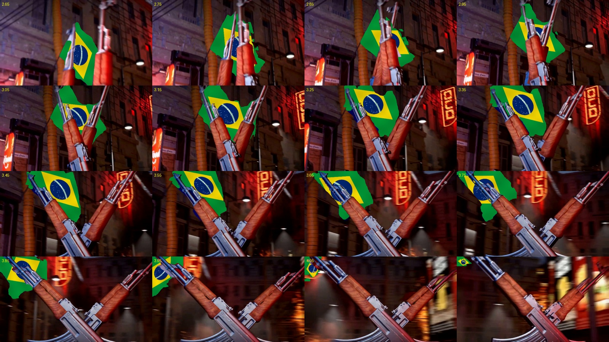

# Intro BR2002 — Brasil, versão 2

[**Baixar a intro corrigida em MP4**](https://raw.githubusercontent.com/mateuszilio225/teste-c/edit-intro-br2002-brasil-v2/edicoes/intro-br2002-brasil/intro-br2002-brasil-v2.mp4)

**13,25 segundos · 1280×720 · 60 fps · 11.8 MB.**

Revisão da substituição da bandeira da Croácia pela do Brasil: recortes refeitos nas passagens rápidas e atrás das armas, nova cobertura opaca do tecido e limpeza das bordas e do brasão antigo. O letreiro BR2002, a duração e o áudio da V1 foram mantidos.

O áudio AAC foi copiado sem recompressão. A comparação dos pacotes confirmou que permanece idêntico ao original; os 795 quadros passaram pela verificação de decodificação.

A edição é uma composição sobre o MP4 enviado. O letreiro e as superfícies foram reconstruídos a partir da referência; uma alteração idêntica dentro da cena 3D exigiria o projeto editável original.

[Versão anterior — V1](https://raw.githubusercontent.com/mateuszilio225/teste-c/edit-intro-br2002-brasil-v1/edicoes/intro-br2002-brasil/intro-br2002-brasil-v1.mp4)

Para novas alterações, indique o segundo do vídeo.

