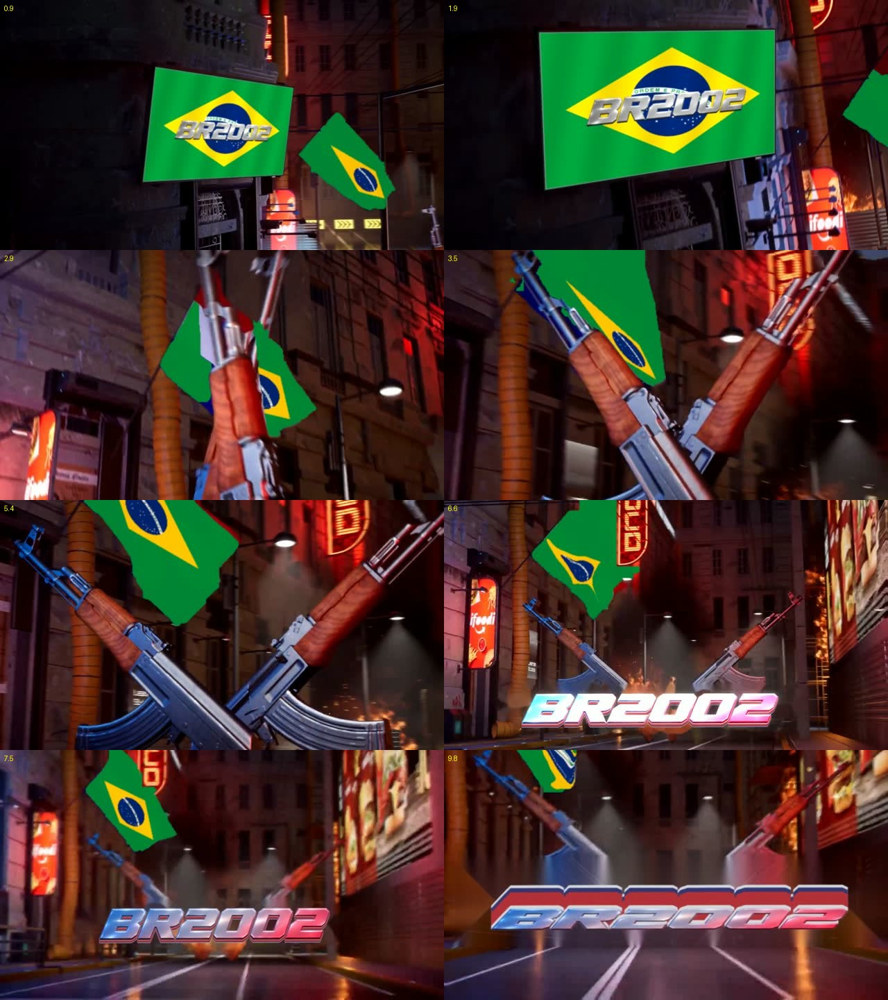

# Intro BR2002 — Brasil, versão 1

[**Baixar a intro MP4**](https://raw.githubusercontent.com/mateuszilio225/teste-c/edit-intro-br2002-brasil-v1/edicoes/intro-br2002-brasil/intro-br2002-brasil-v1.mp4)

**13,25 segundos · 1280×720 · 60 fps · 10,3 MB.**

Adaptação da referência enviada: nome BR2002 no painel e no letreiro principal, com bandeiras do Brasil. A cena do MP4 foi usada como base para preservar o cenário, as armas e os movimentos de câmera. O áudio AAC foi copiado diretamente, sem recompressão; a comparação dos dados dos pacotes confirmou que ele é idêntico ao original.

O letreiro e as superfícies das bandeiras foram reconstruídos e compostos sobre o MP4. A animação do nome é uma reconstrução e pode diferir da referência; uma troca totalmente idêntica dentro da cena 3D exigiria o projeto editável original.

O arquivo mantém a duração e o trecho preto final da referência. Para alterações, indique o segundo do vídeo.

