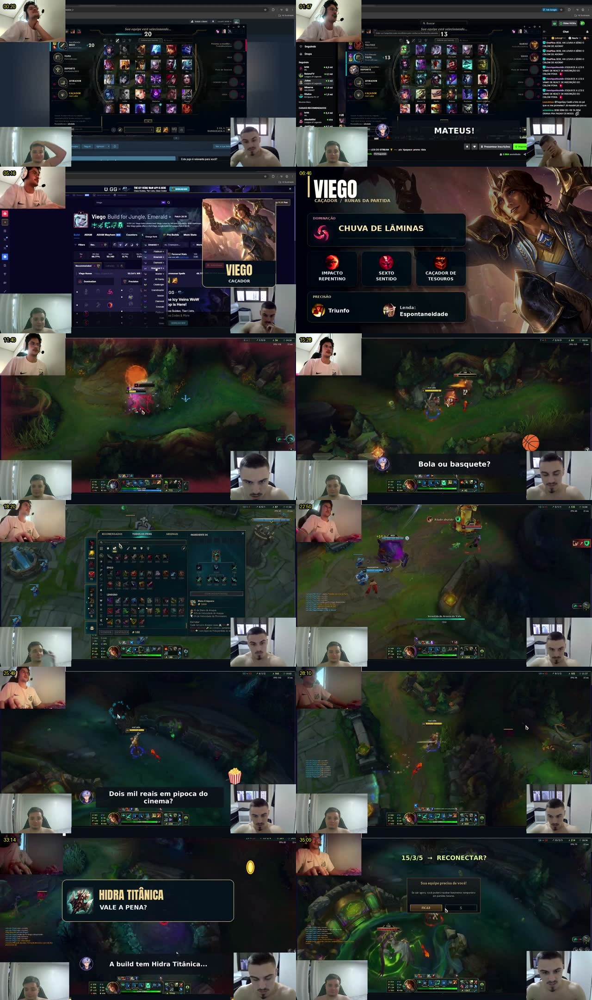

# Viego — gameplay completa, versão 2

[**Baixar o MP4 completo**](https://media.githubusercontent.com/media/mateuszilio225/teste-c/edit-lol-gameplay-completa-v2/edicoes/lol-gameplay-completa-v2/lol-viego-gameplay-completa-v2.mp4) · [Página da versão](https://github.com/mateuszilio225/teste-c/releases/tag/lol-viego-gameplay-v2)

**35min25s · 1280×720 · 60 fps.** A edição segue toda a gravação em ordem, do início do draft ao encerramento, mantendo a preparação e o desenvolvimento das jogadas. A tela do jogo permanece nas conversas. O quadro animado de runas entra antes da gameplay. Há três acelerações breves de jungle, zooms, efeitos e legendas de destaque.

O avatar de anime é o mesmo em todas as legendas e serve apenas como detalhe visual. Não identifica quem fala. A montagem abre no começo da gravação e não antecipa uma luta do final.

`project.json` e `cut-list.csv` registram todos os intervalos usados. Os intervalos de origem são contíguos de **0 a 2150 segundos**, em ordem crescente, usados uma única vez. O quadro de runas é uma inserção de 5,4 segundos. `render-audit.json` registra a verificação de continuidade e quadros.

## Alterações

Envie o minuto e segundo do MP4 exportado. A versão anterior, de 15 minutos, permanece separada no histórico.

## Reprodução do projeto

Os scripts usam `source-original.mp4` e `native-audio.m4a` ao lado do projeto. O vídeo original não foi publicado. Execute `render_edit.py` e `assemble_audio.py`; `finish_export.py` aguarda ambos e faz a montagem e a checagem do arquivo. A transcrição é seletiva: `project.json` guarda apenas as falas destacadas na edição.

O original encerra com a saída/reconexão e retorno ao navegador, sem mostrar a tela final de vitória ou derrota. Essa sequência é preservada.

Arte e ícones de League of Legends: Riot Games / Data Dragon. Avatar de anime original gerado para esta versão; não representa os participantes.

## Prévia visual

