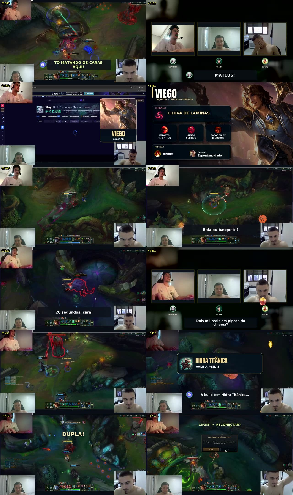

# Viego — gameplay e zoeira, versão 1

Edição de **15min13s**, em **1280×720 a 60 fps**, a partir do original completo enviado pelo SwissTransfer. [Baixar o vídeo MP4 — 249 MB](https://media.githubusercontent.com/media/mateuszilio225/teste-c/edit-lol-viego-v1/edicoes/lol-viego-v1/lol-viego-gameplay-zueira-v1.mp4). A [página da versão](https://github.com/mateuszilio225/teste-c/releases/tag/lol-viego-v1) reúne o vídeo e as informações da edição.

A edição abre com uma amostra da luta, volta ao draft e segue a partida com a preparação das runas, conversas, jogadas e reações. Inclui farm acelerado, enquadramentos das câmeras, legendas de destaque com avatares, zooms, emojis e destaques de campeão/item. A apresentação das runas tem composição própria com arte oficial do Viego; as escolhas seguem o print enviado.

Para pedir alterações, use o minuto/segundo **do MP4 exportado**, por exemplo: “aos 05:20, aumentar a câmera do Lucas”. `project.json` e `cut-list.csv` guardam a correspondência entre o original e a edição. `legendas-destaque.srt` contém apenas as falas destacadas na edição.

O original termina com a saída da partida e a tela de reconexão. A edição preserva esse encerramento; a gravação não mostra vitória ou derrota.

## Arquivos do projeto

- `project.json`: cortes, efeitos, falas destacadas e avatares.
- `render_edit.py`: renderização dos segmentos.
- `assemble_audio.py`: montagem da trilha com a fala e o som de cada trecho.
- `qa_final.py`: conferência dos quadros e montagem do MP4.
- `assets/`: avatares, arte, runas, animação e efeitos usados.

Os scripts esperam `source-original.mp4` (o vídeo original) e `native-audio.m4a` (áudio remuxado do mesmo original) ao lado do projeto. O original não foi publicado aqui. O arquivo `original-verified.json` registra tamanho, procedência e hash. Arte e ícones de League of Legends: Riot Games / Data Dragon, versão 16.23.1.

A referência visual disponível foi a imagem de destaque de item enviada na conversa. O vídeo de referência do Mylon foi localizado, mas a reprodução estava indisponível neste ambiente; a edição não depende de uma alegação de análise quadro a quadro dessa referência.

## Prévia visual

